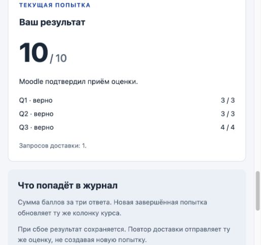
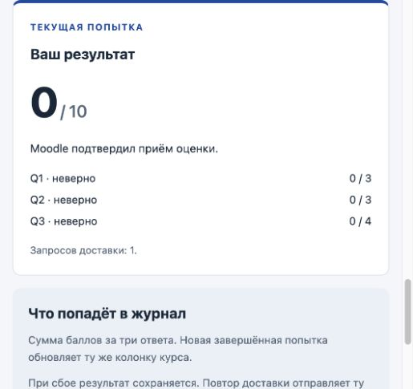
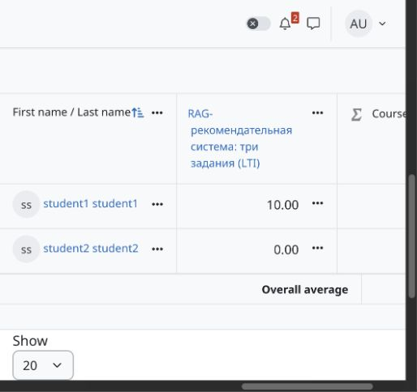

# Отчёт по лабораторной работе «Moodle LTI: три задания»

Дисциплина: «Управление ЭО на веб-платформе». Автор: Крылов Василий. Дата: 11.10.2026.

## 1. Цель, реализация и передача оценки

Разработан внешний учебный тренажёр по теме RAG-рекомендательной системы интернет-магазина. Он получает идентичность и роль участника из проверенного запуска Moodle LTI 1.3, проверяет три коротких ответа на сервере и передаёт итог в существующую колонку журнала через Assignment and Grade Services (AGS). Это отдельное Node.js-приложение, не SCORM-пакет.

| Компонент          | Реализация                                                                    |
| ------------------ | ----------------------------------------------------------------------------- |
| Сервер             | Node.js 24, ESM; Express 5.2.1; ltijs 7.0.7                                   |
| Интерфейс          | HTML, CSS и JavaScript; результат, статусы доставки, история, режим просмотра |
| Хранение           | MongoDB для LTI; JSON-файлы для попыток; MongoDB не является LRS              |
| Локальная LMS      | Moodle 5.3 и PostgreSQL 17 в Docker, только loopback                          |
| Публичная LMS      | eoweblab.gnomio.com, курс Test, элемент LTI с максимумом 10                   |
| Публичный тренажёр | HTTPS Helios: PHP-шлюз, приватный Node.js, MongoDB через Unix-сокет           |

Путь тренажёра: [se.ifmo.ru/~s507353/moodle-lti-rag/](https://se.ifmo.ru/~s507353/moodle-lti-rag/). Запуск с правом оценивания производится [из элемента курса Moodle](https://eoweblab.gnomio.com/mod/lti/view.php?id=6), а не прямым открытием страницы приложения.

```text
Moodle: пользователь + курс + resource link + роль + line item
  -> OIDC / подписанный LTI-запуск / проверка ltijs
  -> серверная сессия -> браузер: answers + requestId + CSRF
  -> валидация -> grade(): 3 + 3 + 4 -> сохранение pending
  -> OAuth -> AGS: userId + scoreGiven + scoreMaximum=10
  -> подтверждение sent -> та же колонка журнала Moodle
```

Пользователь определяется по проверенному LTI user ID, а не по ответу браузера. Правильные ответы, максимум, адрес line item и начисленные баллы остаются на сервере. POST требует действующую сессию, CSRF и точный Origin. Learner может отвечать; Instructor получает просмотр, а прямые POST отклоняются.

Попытка сохраняется до обращения к AGS. При ошибке доставки она остаётся pending и повторяется с прежними UUID, ответами и баллами. Подтверждённый UUID не отправляется снова. «Новая попытка» доступна после sent, архивирует результат и позволяет обновить ту же колонку. Exactly-once не обещается: при потере ответа после принятия Moodle возможна повторная доставка той же оценки.

## 2. Собственные вопросы и правила оценивания

### q1. Подход к генерации ответа - 3 балла

Ассистент интернет-магазина сначала извлекает релевантные фрагменты описаний товаров из базы знаний, затем передаёт их языковой модели для генерации ответа покупателю. Как называется этот подход? Введите общепринятую аббревиатуру из трёх латинских букв.

Эталон: **rag**. Проверяется понимание извлечения контекста перед генерацией ответа.

### q2. Векторное представление - 3 балла

Для семантического поиска модель преобразует запрос покупателя в плотный числовой вектор, который сравнивается с векторами фрагментов базы знаний. Как называется такое векторное представление? Введите английский термин в единственном числе.

Эталон: **embedding**. Проверяется понимание представления запроса в векторном пространстве.

### q3. Актуальность цены и наличия - 4 балла

Перед рекомендацией товара нужно подтвердить его текущую цену и наличие. Доступны три источника: LLM - память языковой модели; INDEX - векторный индекс, обновлённый вчера; API - ответ информационной системы магазина с ценой и остатком на текущий момент. Какой источник следует использовать для этой проверки? Введите одно обозначение: LLM, INDEX или API.

Эталон: **api**. По условию только этот источник содержит текущие цену и остаток.

### Общие правила

Сервер применяет `trim().toLowerCase()`: регистр и пробелы по краям не учитываются. Принимается один эталон для каждого вопроса; перевод, множественное число и пунктуация не являются синонимами автоматически. За правильный ответ начисляется полный вес, за неверный или пустую строку - 0. Общий максимум: **10 баллов**.

| Ввод                                            | Результат                             |
| ----------------------------------------------- | ------------------------------------- |
| Пустые строки q1/q2/q3                          | 0/10; это допустимые неверные ответы  |
| rag / неверно / api                             | 7/10                                  |
| rag / embedding / api                           | 10/10                                 |
| rag / embedding / INDEX                         | 6/10; собственный дополнительный тест |
| Нет q3; лишнее поле; не строка; длина более 200 | HTTP 400, без сохранения и AGS        |

Определения: `src/grading.mjs`; подробное описание: `docs/questions.md`; тесты: `test/grading.test.mjs`. Публичные задания не содержат поля answer.

## 3. Настоящий Gnomio: последовательность оценок

11.10.2026 зарегистрирован LTI 1.3 инструмент с JWKS и запуском в новом окне. Разрешён только AGS grade sync. Имя, email и список участников на Helios не передаются. В курсе Test создан один новый элемент: course-module ID 6, общий grade item ID 5, максимум 10. Прежние SCORM не изменялись.

| Сценарий                              | Ожидалось | В тренажёре          | В журнале Moodle     |
| ------------------------------------- | --------- | -------------------- | -------------------- |
| A: student1, все поля пустые          | 0/10      | 0/10, sent           | 0.00                 |
| A: RAG / INDEX / API                  | 7/10      | 7/10, sent           | 7.00, та же строка   |
| A: rag / Embedding / api, с пробелами | 10/10     | 10/10, sent          | 10.00, та же строка  |
| B: student2, все поля пустые          | 0/10      | 0/10, sent           | 0.00                 |
| Проверка A после ответа B             | 10/10     | без новой отправки A | 10.00, не изменилось |

Первые три отправки A выполнены через штатное Moodle «Войти как». Затем пользователь самостоятельно вошёл под student1: новый запуск из курса восстановил 10/10 и две предыдущие попытки 7/0, без новой отправки. B проверен через самостоятельный вход student2, не переключение роли администратора. Пароли вводил пользователь; агент их не читал и не сохранял.





Это реальные подписанные запуски и OAuth/AGS через Helios. Статус приложения дополнительно проверен чтением настоящего журнала Moodle, а не только сообщением «доставлено».

## 4. Общая колонка и изоляция участников

После отправки B администратор открыл Grader report курса Test. Одна и та же колонка «RAG-рекомендательная система: три задания (LTI)» содержит **student1 = 10.00** и **student2 = 0.00**. Оценки не исправлялись вручную; overrides не применялись.



| Проверка                      | Наблюдение                                        |
| ----------------------------- | ------------------------------------------------- |
| Новый подписанный запуск B    | Learner; LTI user ID 4, не ID 3 участника A       |
| До первой отправки B          | Нет текущей попытки; 0 предыдущих попыток         |
| После отправки и обновления B | Текущие 0/10; история пустая; запросов доставки 1 |
| Чужая история у B             | Предыдущие 7/0 участника A не показаны            |
| Журнал после действия B       | A сохранил 10; B получил 0; общий grade item ID 5 |

Текущая попытка не входит в список предыдущих, пока не нажата «Новая попытка». Поэтому у B результат 0 существует, а счётчик предыдущих попыток равен 0. Снимок журнала сделан с горизонтальной прокруткой к LTI-колонке; остальные элементы курса не удалялись и не скрывались.

Полные снимки, снимок начальной пустой сессии B и машинный протокол находятся в `docs/screenshots/` и `docs/gnomio-lti-evidence.json`. Проверка доказывает наблюдаемое разделение историй через UI; защита границ хранилища дополнительно проверена автоматическими тестами. SQL-история удалённого Gnomio не исследовалась.

## 5. Настоящий локальный Moodle: роли и отрицательные запросы

На локальном Moodle 10.10.2026 отдельно проверены 0/7/10 для двух настоящих тестовых учётных записей. Итог оставлен **А = 10, Б = 7** в единственной колонке. Это другой стенд и другие пользователи, не противоречие публичному результату 10/0. Источник записей Moodle: `modltiservice_gradebookservices`.

Отдельный неадминистративный lti_instructor имеет только курсную роль teacher. Подписанный запуск содержит Instructor, приложение показывает learner=false, пустую историю и заблокированные поля. Оба POST преподавателя возвращают 403; его оценки и файла попыток нет.

| Живой отрицательный запрос      | Ожидалось | Получено                    |
| ------------------------------- | --------- | --------------------------- |
| Подмена userId другого ученика  | 400       | 400, invalid_body           |
| Передача scoreGiven из браузера | 400       | 400, invalid_body           |
| Отсутствует q3                  | 400       | 400, AnswersValidationError |
| Нет CSRF                        | 403       | 403, invalid_csrf           |
| Неверный CSRF                   | 403       | 403, invalid_csrf           |
| Нет Origin                      | 403       | 403, cross_origin           |
| Чужой Origin                    | 403       | 403, cross_origin           |
| Instructor: POST submit         | 403       | 403, read_only              |
| Instructor: POST new-attempt    | 403       | 403, read_only              |

После каждого отказа независимым CLI Moodle прочитаны оценки и история; сравнен состав и SHA-256 файлов попыток. Ничего не изменилось. Эти девять запросов использовали реальные Moodle/LTI-сессии и MongoDB, не поддельные JWT. Протокол: `docs/local-lti-negative-evidence.json`; описание и снимки: `docs/local-lti-final-checks.md`.

Дополнительные оригинальные снимки включены в архив: `docs/screenshots/moodle-lti-gradebook-final.jpg` (локальные 10/7), `docs/screenshots/moodle-lti-instructor-final.jpg` (режим Instructor). Наглядный HTML-протокол отрицательных запросов не является снимком DevTools.

В Gnomio отдельно наблюдался только просмотр администратора с курсной ролью Teacher. Неадминистративный Instructor и аутентифицированные 400/403 именно в Gnomio не повторялись; доказательство этих сценариев относится к локальному Moodle.

## 6. Автоматические тесты и воспроизведение

11.10.2026 команда `npm test` завершилась с кодом 0: **63 теста, 63 успешно, 0 ошибок, 0 пропусков**. Локально Node.js v24.10.0, npm 11.12.1. Сводка запуска: `docs/test-results.json`. Исторические 59/59 в старых локальных протоколах относятся к более ранней версии набора.

Проверяются серверное оценивание и нормализация, контракт стартера, допустимый ввод, роль, CSRF/Origin, подпись/deployment/expiry/nonce, изоляция A/B, сохранение до AGS, pending, подтверждённый повтор и потерянный ответ AGS. Дополнительный тематический тест: вчерашний INDEX в q3 не засчитывается, итог при верных q1/q2 равен 6/10.

Автоматические интеграционные тесты используют настоящий ltijs и HTTP, но Moodle и адаптер его LTI-хранилища заменены тестовыми реализациями. Они не доказывают реальную настройку Gnomio. Ошибка AGS, повтор nonce и неоднозначный сетевой сбой проверены контролируемо в тестах; настоящий публичный Moodle для этого не отключался.

### Быстрая самопроверка без LMS

```sh
make install
make test
make demo
```

Открыть `http://127.0.0.1:3001`, выбрать тестового участника. Здесь Moodle имитируется; оценка не отправляется в Gnomio. Контролируемый сбой AGS позволяет показать pending и повтор доставки.

### Настоящий локальный Moodle и LTI

```sh
make moodle-init
make lti-local-init
make lti-local-start
# В другом терминале:
make lti-local-activate
make lti-local-status
```

Нужны Docker Desktop, Make и Node.js 24+. Подготовка создаёт приватную конфигурацию и сохраняет существующие пароли/тома. Подробности: `docs/local-moodle.md`, `docs/local-lti.md`. Для девяти отрицательных проверок: `make lti-local-verify`, только после обычного получения А=10 и Б=7. Эти значения команда сама не исправляет.

Для новой удалённой LMS нужны собственная LTI-регистрация и заполненные MOODLE_* в приватном env. Публичные URL регистрации описаны в `docs/moodle-setup.md`; вариант Helios - в `docs/helios.md`. Архив без секретов не воспроизводит чужие учётные записи, ключи или накопленные оценки.

## 7. Комплект для сдачи и границы результата

Сверка с Moodle_LTI_Three_Tasks_Lab.pdf, страница 17:

| Требование                                           | Подготовленный материал                                                   |
| ---------------------------------------------------- | ------------------------------------------------------------------------- |
| Исходники без секретов и краткий запуск              | Архив текущего дерева проекта; README; пустые секретные поля env-примеров |
| Тема, три вопроса, ответы, нормализация и веса       | Раздел 2 отчёта; docs/questions.md; src/grading.mjs                       |
| Снимки A/B, журнал, ожидалось/получено               | Разделы 3-5; docs/screenshots; JSON-протоколы                             |
| Результат npm test и собственный тест                | Раздел 6; docs/test-results.json; test/grading.test.mjs                   |
| Схема, повтор доставки и индивидуальная демонстрация | Раздел 1; docs/defense.md с планом изменения одного правила               |

В репозитории доступны актуальные исходники и lockfile. Отдельный архив собран из рабочего дерева на этапе подготовки материалов, а не из старого HEAD. Не включаются `.git`, node_modules, реальные `.env*`, data, keys, приватные PEM и ключи. `.env.example`, `.env.moodle.example` и `.env.helios.example` содержат только шаблоны и публичные адреса. Пометки об отсутствии Git stage/commit/push в машинных протоколах относятся к моменту соответствующей проверки, до публикации изменений. Перед отправкой проверяющему архив нужно передать самостоятельно.

Реализованная функциональность и перечисленные контрольные сценарии подтверждены. Индивидуальная защита, самостоятельное изменение правила при преподавателе и оценка работы преподавателем ещё не состоялись.

### Эксплуатационные ограничения

- Один Node-процесс на DATA_DIR; сессии в памяти. После перезапуска нужен новый запуск из Moodle, а попытки сохраняются.
- Автозапуск после перезагрузки Helios не настроен. При необходимости используется make helios-start.
- Helios имеет общий origin и общие access logs; стенд предназначен только для вымышленных участников, не production-данных.
- Защита папок mkdocs-deployment-lab и moodle-lti-rag в деплое портфолио подготовлена локально, но ещё не отправлена в GitHub. Старый workflow портфолио нельзя запускать, пока исключения не опубликованы.
- На этапе подготовки отчёта GitHub CI ещё не запускался; текущий статус запусков доступен в [GitHub Actions](https://github.com/WhoamiTitle/moodle-lti-rag-lab/actions). Локальные контейнеры Moodle/PostgreSQL при подготовке этого отчёта не поднимались.

### Основания отчёта

Исходное задание: Moodle_LTI_Three_Tasks_Lab.pdf (07.10.2026), контрольные сценарии на страницах 13-14, комплект сдачи на странице 17. Контракт: README преподавательского Moodle_LTI_Three_Tasks_Starter.zip. Реализация: файлы src/public/test проекта; подтверждения: docs/gnomio-lti-evidence.json, docs/local-lti-evidence.json и docs/local-lti-negative-evidence.json. Это самопроверка с отдельным чтением получателя Moodle, не независимый аудит другим проверяющим.
